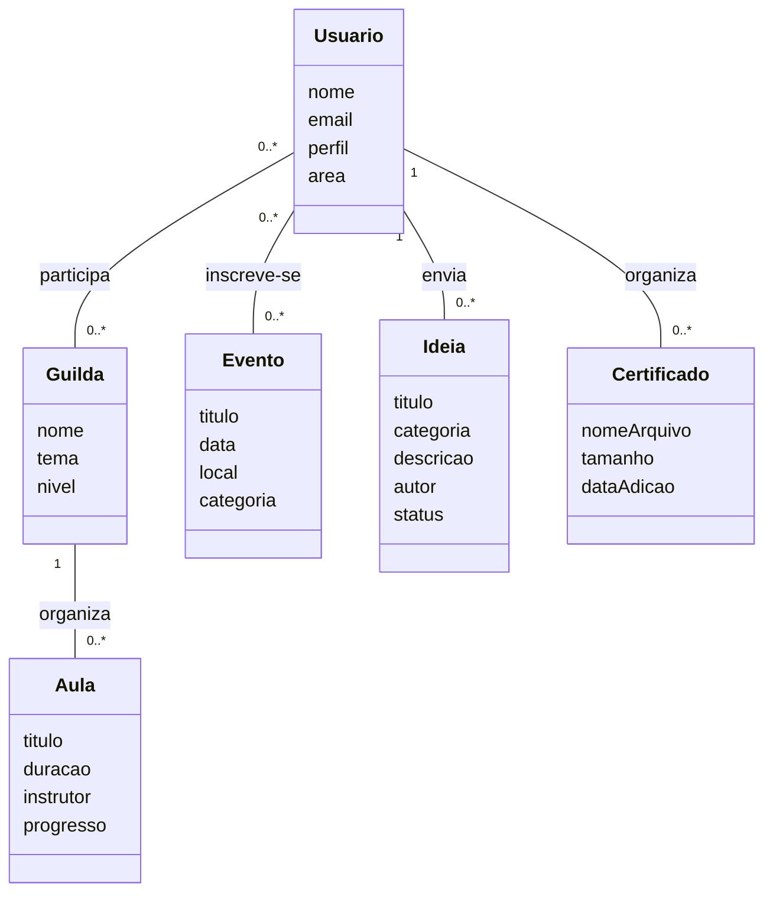
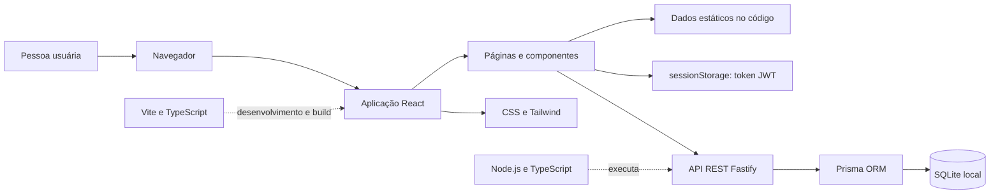

# ByteHub — Relatório Técnico

**Trabalho Final de Engenharia de Software II — 2026/2**  
**Instituição/turma:** [preencher]  
**Grupo:** [preencher nome do grupo]  
**Integrantes:** [preencher de 3 a 4 nomes]  
**Data:** 16 de novembro de 2026

> **Antes de entregar:** substituir todos os campos `[preencher]`, registrar apenas testes realmente executados e inserir capturas de tela próprias. Este documento descreve o estado observado do protótipo; não afirma que funcionalidades planejadas já foram implementadas.

## 1. Introdução

O ByteHub é um protótipo de aplicação web para apoiar a organização da liga acadêmica Byte Builders. A proposta é reunir em um único espaço informações sobre a liga, diretoria, guildas temáticas, aulas, eventos, certificados e ideias enviadas pelos estudantes. O protótipo apresenta áreas diferentes para aluno, diretoria e presidência.

O problema abordado é a dispersão de informações e oportunidades de participação. Como resposta, a interface oferece uma visão centralizada das atividades da comunidade e caminhos para conhecer guildas, acompanhar conteúdos e participar de eventos.

**Objetivo da versão apresentada:** [descrever o recorte que o grupo pretende demonstrar].  
**Público-alvo:** estudantes participantes ou interessados na liga e pessoas responsáveis por sua organização.

### 1.1 Escopo atual e limites

O ByteHub agora tem front-end React conectado a uma API local Fastify. Perfis, participação em guildas, inscrições em eventos, propostas e status das propostas, além dos metadados de certificados, são persistidos em um arquivo SQLite por meio do Prisma. Eventos e guildas iniciais são exemplos de demonstração; aulas e parte das informações dos painéis permanecem estáticas. Certificados guardam metadados, não o arquivo original.

O sistema foi preparado para execução neste computador. O banco não é compartilhado com outros dispositivos e ainda não há cópia de segurança automática. As senhas de demonstração são fracas e não devem ser reutilizadas fora da apresentação.

## 2. Requisitos e modelagem

### 2.1 Requisitos funcionais identificados

| ID | Requisito | Situação no protótipo |
| --- | --- | --- |
| RF01 | Entrar em áreas de aluno e gestão usando perfis de demonstração | Implementado pela API com token de sessão |
| RF02 | Criar perfil de aluno | Implementado; perfil persistido no SQLite |
| RF03 | Permitir que a presidência crie perfil de diretoria | Implementado; acesso restrito à presidência |
| RF04 | Consultar a apresentação da liga e sua diretoria | Implementado com conteúdo estático |
| RF05 | Pesquisar guildas por nome | Implementado na tela com dados da API |
| RF06 | Consultar aulas e filtrar por tema | Implementado com conteúdo estático; reprodução é simulada |
| RF07 | Consultar eventos e solicitar inscrição | Implementado; inscrições persistidas no SQLite por usuário |
| RF08 | Enviar uma proposta para a liga | Implementado; propostas e status persistidos no SQLite |
| RF09 | Adicionar certificados à área pessoal | Persiste nome, tamanho e data no SQLite; não armazena o arquivo |
| RF10 | Consultar avisos e notificações | Conteúdo demonstrativo |

### 2.2 Histórias de usuário

- **Como estudante**, quero conhecer as guildas para escolher um tema de aprendizagem.
- **Como estudante**, quero consultar aulas e eventos para acompanhar as atividades da liga.
- **Como estudante**, quero enviar uma ideia para sugerir uma atividade ou melhoria.
- **Como estudante**, quero organizar os metadados dos meus certificados em um só lugar.
- **Como integrante da diretoria**, quero consultar informações sobre setores e guildas para compreender a organização da liga.
- **Como presidente**, quero criar um perfil de acesso para um integrante da diretoria.

### 2.3 Modelo conceitual

O modelo abaixo representa os conceitos do domínio implementados no banco. Usuários, guildas, associações, eventos, inscrições, ideias e certificados são tabelas relacionadas no schema Prisma. Aulas ainda são dados estáticos do front-end.

## 3. Arquitetura do software

### 3.1 Arquitetura adotada

O front-end segue uma arquitetura de página única (SPA). O React monta a aplicação no navegador; componentes de página consultam a API REST para autenticação, guildas, eventos, ideias e certificados. O Vite fornece o servidor de desenvolvimento e o processo de build. O backend em Node.js/Fastify valida as requisições e acessa o arquivo SQLite por meio do Prisma. O JWT de autenticação é mantido no `sessionStorage` da aba do navegador.

### 3.2 Componentes principais

| Componente | Responsabilidade |
| --- | --- |
| `App` | Mantém perfil ativo, navegação, busca global e notificações temporárias |
| `LoginPage` | Autentica pela API e permite criar perfil de aluno |
| `AdminHome` / `StudentHome` | Apresentam painéis diferentes por perfil |
| `BoardPage` | Exibe setores e membros da diretoria |
| `GuildsPage` / `MyGuildPage` | Consulta guildas da API, registra e mostra associações do usuário |
| `LessonsPage` | Lista aulas estáticas e permite filtrar por tema |
| `EventsPage` | Consulta eventos e inscrições na API; registra novas inscrições |
| `IdeasPage` | Envia e consulta propostas; permite à gestão atualizar status |
| `CertificatesPage` | Registra e remove metadados de certificados pela API |
| `PresidentProfilesPage` | Consulta e cria perfis de diretoria pela API |
| Backend Fastify | API local com autenticação, autorização por perfil e rotas do domínio |

### 3.3 Tecnologias e ferramentas

- React 19 e React DOM 19;
- TypeScript 5.7;
- Vite 8;
- Tailwind CSS 4 e CSS;
- pnpm para gerenciamento de dependências;
- Fastify 5 para a API REST local;
- Prisma ORM 7 e SQLite para persistência em arquivo;
- Figma Make como ambiente/origem do protótipo visual [confirmar descrição exata do fluxo usado pelo grupo].

### 3.4 Justificativas e decisões

React permite decompor a interface por páginas e componentes reutilizáveis. TypeScript ajuda a explicitar formatos como perfil e papel de acesso. Vite oferece inicialização e atualização rápida. SQLite guarda dados em arquivo local sem exigir um serviço separado; Fastify fornece a API entre a interface e os dados. O backend faz hash das senhas e emite tokens JWT.

## 4. Gestão da configuração

### 4.1 Situação observada

O projeto contém `.gitignore` e `.gitattributes`, mas a pasta entregue não apresenta histórico Git inicializado (o comando `git status` não encontrou repositório). Assim, ainda não há evidência local de branches, commits, pull requests ou integração contínua. O grupo deve confirmar se o controle de versão está em outro endereço e registrar o link do repositório, se houver.

**Repositório remoto:** [inserir link ou informar que não foi criado]  
**Responsável pela integração:** [preencher]  
**Estratégia realmente usada pelo grupo:** [preencher com fatos; não declarar Git Flow se não foi usado].

### 4.2 Processo recomendado para concluir a entrega

1. Criar ou confirmar um repositório Git compartilhado e adicionar todos os integrantes.
2. Manter `main` como versão apresentável e fazer cada mudança em branch curta, por exemplo `feat/inscricao-evento` ou `docs/relatorio`.
3. Fazer commits pequenos com mensagens que indiquem a mudança, como `feat: persistir ideias pela API` ou `docs: registrar estratégia de testes`.
4. Revisar as mudanças com pelo menos outro integrante antes de integrar.
5. Manter README, documentação e aplicação na mesma versão demonstrada.

## 5. Qualidade do software

### 5.1 Atributos considerados

- **Usabilidade:** navegação por áreas, rótulos em português, busca, feedback visual e adaptação para telas menores foram considerados na interface.
- **Manutenibilidade:** componentes e tipos TypeScript dão estrutura inicial; `App.tsx` concentra muitos componentes e dados, o que pode dificultar evolução e sugere extração para módulos menores.
- **Confiabilidade:** dados de contas e fluxos principais persistem em SQLite, mas ainda não há cópia automática de segurança. O token fica no `sessionStorage` e expira após oito horas.
- **Segurança:** o backend guarda hash de senha com salt, valida dados de entrada e restringe rotas por perfil. Os logins demonstrativos têm senhas fracas e devem ser usados apenas localmente.
- **Portabilidade:** a aplicação web pode ser executada em navegadores modernos com Node.js/pnpm disponíveis para desenvolvimento. Compatibilidade real entre navegadores e dispositivos ainda deve ser verificada pelo grupo.
- **Desempenho:** não há medições ou ferramenta de desempenho registradas até o momento.

### 5.2 Evidências a reunir

Inserir capturas próprias de: login, painel de aluno, painel de gestão, tela de guildas, formulário de ideias, certificados e visualização em celular. Para acessibilidade/usabilidade, registrar o roteiro usado, participantes (com consentimento) e problemas encontrados. Não afirmar resultados de avaliação sem tê-la realizado.

**Métricas coletadas:** [preencher ou registrar “não coletadas”].  
**Problemas encontrados e correções:** [preencher depois de executar a revisão/testes].

## 6. Testes realizados e resultados

Os front-end e backend compilam sem erros de TypeScript. O backend tem 39 testes automatizados de integração em `figma/backend/tests/api.test.ts`, executados com banco SQLite temporário. Na última execução, os 39 testes passaram e nenhum falhou. Os cenários manuais de interface abaixo ainda precisam ser executados pelo grupo e registrados.

### 6.1 Estratégia

Executar testes manuais de fluxo na interface, cobrindo cada perfil e os principais caminhos. Registrar em cada caso: navegador/dispositivo, pré-condição, passos, resultado esperado, resultado observado, status (passou/falhou) e captura. Se o grupo corrigir um problema, repetir o caso e anotar a alteração. A compilação TypeScript do front-end e do backend foi concluída sem erros; isso não substitui os testes funcionais da tabela.

### 6.2 Casos para executar

| ID | Cenário | Resultado esperado | Resultado observado/status |
| --- | --- | --- | --- |
| CT01 | Entrar como aluno (`aluno` / `4321`) | Abrir painel de aluno | [executar e preencher] |
| CT02 | Entrar como diretoria (`admin` / `1234`) | Abrir painel de gestão | [executar e preencher] |
| CT03 | Entrar como presidência (`presidencia` / `0000`) | Mostrar opção de criar perfil | [executar e preencher] |
| CT04 | Informar credencial incorreta | Mostrar mensagem de erro sem entrar | [executar e preencher] |
| CT05 | Pesquisar um termo existente na tela de guildas | Filtrar os cartões correspondentes | [executar e preencher] |
| CT06 | Filtrar aulas por tema | Exibir as aulas daquele tema | [executar e preencher] |
| CT07 | Enviar formulário de ideia preenchido como aluno | Mostrar confirmação e proposta pendente em “Minhas ideias” | [executar e preencher] |
| CT08 | Entrar como gestão e atualizar status de uma proposta | Status escolhido deve continuar após navegar/sair e entrar novamente | [executar e preencher] |
| CT09 | Adicionar certificado aceito | Mostrar metadados após a seleção | [executar e preencher] |
| CT10 | Inscrever-se em evento e guilda | Atualizar botões para “Inscrito” e impedir duplicidade | [executar e preencher] |
| CT11 | Atualizar a página ou reiniciar os servidores após criar perfil/certificado | Verificar a persistência no SQLite e o novo login | [executar e preencher] |
| CT12 | Abrir a interface em viewport móvel | Verificar navegação e conteúdo sem corte | [executar e preencher] |

**Ferramentas usadas:** [preencher; por exemplo, navegador e DevTools somente se realmente usados].  
**Evidências:** [adicionar imagens em `docs/evidencias/` e referenciá-las].  
**Bugs e correções:** [preencher após execução].

### 6.3 Resultado consolidado

**Suíte automatizada do backend:** 39 passaram, 0 falharam.  
**Comando:** `corepack pnpm test` (na pasta `figma/backend`).  
**Banco de teste:** SQLite temporário em `tests/data/`, removido ao final da execução.

Os campos a seguir referem-se aos casos manuais de interface da tabela 6.2:

| Total executado | Passou | Falhou | Não executado |
| ---: | ---: | ---: | ---: |
| [ ] | [ ] | [ ] | [ ] |

## 7. Participação dos integrantes

Preencher com nomes e atividades reais; alinhar esta seção aos commits, arquivos, atas ou outras evidências disponíveis.

| Integrante | Atividades e contribuição individual | Evidência/artefato |
| --- | --- | --- |
| [Nome 1] | [preencher] | [preencher] |
| [Nome 2] | [preencher] | [preencher] |
| [Nome 3] | [preencher] | [preencher] |
| [Nome 4, se houver] | [preencher] | [preencher] |

## 8. Aprendizados e perspectivas futuras

### 8.1 Aprendizados e dificuldades

Cada integrante deve registrar uma aprendizagem específica e uma dificuldade real enfrentada, explicando como o grupo respondeu. Sugestões para reflexão: decomposição de interface, modelagem de requisitos, integração de contribuições, persistência, validação com usuários e limites de um protótipo sem backend.

- **Aprendizado do grupo:** [preencher com a experiência real].
- **Dificuldade encontrada:** [preencher].
- **Estratégia adotada e resultado:** [preencher].
- **Reflexão individual/profissional:** [preencher ao menos uma contribuição por integrante].

### 8.2 Próximos passos

1. Executar os testes funcionais manuais e registrar evidências e correções.
2. Implementar telas de administração para criar e editar eventos e guildas.
3. Armazenar os arquivos de certificados, com limites e controle de acesso, se isso fizer parte do escopo.
4. Ampliar os testes automatizados conforme novas funcionalidades forem implementadas.
5. Criar rotina de cópia de segurança do SQLite.
6. Avaliar usabilidade e acessibilidade com participantes e registrar os resultados.

## 9. Referências

- Documentação oficial do React: https://react.dev/ (acesso em [preencher]).
- Documentação oficial do TypeScript: https://www.typescriptlang.org/docs/ (acesso em [preencher]).
- Documentação oficial do Vite: https://vite.dev/ (acesso em [preencher]).
- Documentação oficial do Tailwind CSS: https://tailwindcss.com/docs (acesso em [preencher]).
- Documentação oficial do Fastify: https://fastify.dev/docs/latest/ (acesso em [preencher]).
- Guia oficial do Prisma ORM 7 com SQLite: https://www.prisma.io/docs/v7/prisma-orm/quickstart/sqlite (acesso em [preencher]).
- [Adicionar referências efetivamente consultadas pelo grupo.]
